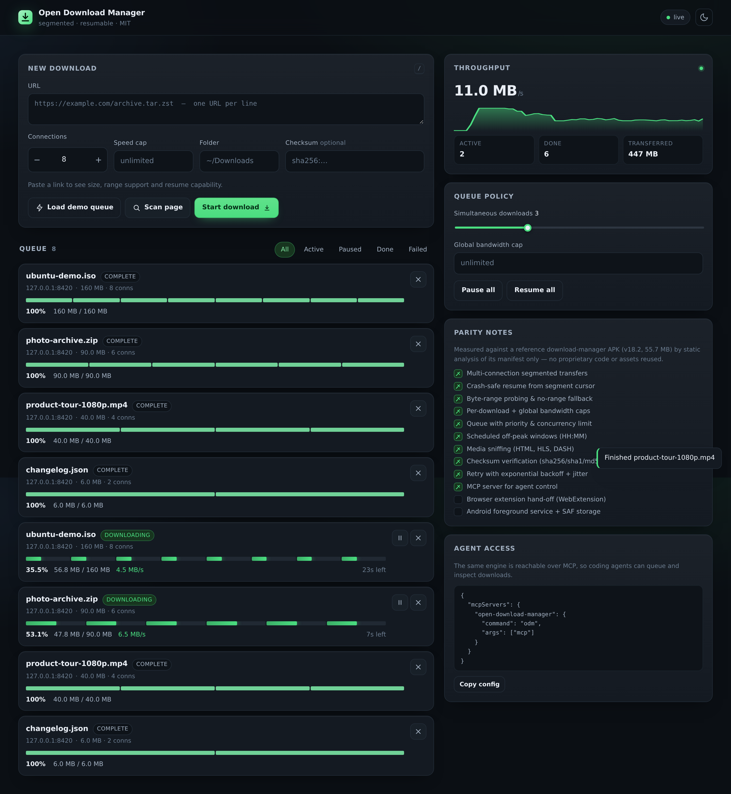

<p align="center">
  
</p>

<h1 align="center">Open Download Manager</h1>

<p align="center">
  <b>A clean-room, MIT-licensed download manager: segmented transfers, crash-safe resume, bandwidth shaping, media grabbing and an MCP server — in ~2,600 lines of dependency-free Node.js.</b>
</p>

<p align="center">
  
  
  
  
  
</p>

<p align="center">
  <a href="#quick-start">Quick start</a> ·
  <a href="docs/AUDIT.md">Audit report</a> ·
  <a href="#what-it-does">What it does</a> ·
  <a href="#architecture">Architecture</a> ·
  <a href="#cli">CLI</a> ·
  <a href="#agent-access-mcp">MCP</a> ·
  <a href="docs/PARITY.md">Parity report</a> ·
  <a href="docs/DESIGN.md">Design system</a> ·
  <a href="docs/AUDIT.md">Audit</a> ·
  <a href="docs/LEGAL.md">Legal boundary</a>
</p>

---

## Why this exists

Commercial download managers earn their keep with four ideas: **split one transfer into many connections**, **persist per-segment progress so a crash is not a restart**, **shape bandwidth**, and **grab media off a page**. The protocols behind all four are public — `Range`, `Content-Range`, `ETag`, HLS, DASH.

This project reimplements those ideas from the specifications, not from anyone's binaries. It is a **clean-room** effort: no decompiled code, no extracted resources, no proprietary assets. See [`docs/LEGAL.md`](docs/LEGAL.md) and the evidence trail in [`docs/PARITY.md`](docs/PARITY.md).

## Quick start

```bash
git clone https://github.com/j97970293-lang/open-download-manager
cd open-download-manager

npm test          # 22 engine tests (no network needed)
npm run smoke     # end-to-end: CLI + REST + SSE + MCP against a local server
npm start         # API + dashboard → http://localhost:8420
```

No `npm install` is required: the runtime has **zero third-party dependencies** (Node 20+ built-ins only).

```bash
node apps/cli/bin/odm.js add https://example.com/arch.iso -c 16 -l 5MB
node apps/cli/bin/odm.js list
node apps/cli/bin/odm.js serve --port 8420
```

## What it does

| Capability | How it works |
| --- | --- |
| **Segmented transfers** | Probes `Accept-Ranges`/`Content-Range`, splits the file into N contiguous windows, runs a bounded worker pool |
| **Crash-safe resume** | Per-segment cursor persisted to disk (`jobs/<id>.json`) every 1.5 s; restart resumes from each cursor, not from zero |
| **Server-drift detection** | Re-probes the origin on resume; refuses to splice two versions together (`RESUME_MISMATCH`) — found missing by the audit, now enforced and tested |
| **No silent overwrite** | Destination collisions become `name (1).ext`, announced and persisted |
| **No hung tasks** | Every filesystem call has a deadline; an unusable destination fails in ms, not after a transfer |
| **No-range fallback** | Falls back to a single stream with its own byte-offset checkpointing |
| **Bandwidth shaping** | Token bucket per job **and** one global bucket shared by every connection |
| **Retries** | Full-jitter exponential backoff; honours `Retry-After`; distinguishes retryable (`5xx`, `408`, `429`) from terminal (`404`, `403`) |
| **Integrity** | `sha256` / `sha1` / `md5` / `sha512` verification after transfer; magic-byte sniffing for MIME/filename correction |
| **Queue** | Priority bands, FIFO inside a band, global concurrency cap, pause-all |
| **Scheduling** | Daily `HH:MM-HH:MM` windows (crossing midnight supported) for off-peak runs |
| **Media grabber** | HTML scan (`<video>`, `<source>`, `og:video`, links, inline scripts) + HLS master playlists + DASH MPD variant ranking |
| **HLS concatenation** | Media playlist → **one file**, segments written in order with per-segment resume; master playlists pick the best variant; encrypted playlists refused |
| **Agent access** | MCP server (stdio JSON-RPC 2.0) exposing 7 tools, 2 resources and 1 prompt |
| **UI** | Server-rendered shell + SSE live stream, one card per transfer with per-connection segments |

## Architecture

```
packages/core/            ← the engine (zero deps, pure Node)
  src/net.js              capability probe (HEAD → ranged GET fallback), ranged streaming
  src/downloader.js       DownloadTask: state machine, worker pool, retries, checksum
  src/segments.js         segment plan, preallocated TargetFile (positional writes), drift checks
  src/queue.js            QueueManager: priority, concurrency, global limiter
  src/rate.js             TokenBucket + RateLimiter
  src/store.js            atomic JSON persistence (tmp + rename), one sidecar per job
  src/media.js            HTML/HLS/DASH discovery + manifest parsing
  src/checksum.js         hashing + magic-byte sniffing
  src/scheduler.js        off-peak windows
apps/server/src/server.js REST + SSE + static dashboard (+ deterministic demo server)
apps/server/src/mcp.js    MCP server over stdio (JSON-RPC 2.0)
apps/cli/bin/odm.js       CLI
apps/web/public            dashboard (vanilla ES modules, no build step)
docs/                     parity report, design system, legal boundary
```

### The transfer, step by step

```
probe ─► plan segments ─► worker pool ─► positional writes ─► verify ─► complete
  │           │                │                  │
  │           │                └── each segment keeps its own cursor in memory
  │           └── [[0..n],[n+1..m],…] written to jobs/<id>.json
  └── Accept-Ranges? size? ETag? filename? ── no ranges ─► single stream + checkpoints
```

Every 1.5 s the task writes its cursors atomically. Kill the process mid-transfer and the next run continues each segment exactly where it stopped — the property that makes a download manager worth having on a flaky link.

## CLI

```
odm add <url...>            download one or more URLs
odm list [--json]           show the queue
odm watch [id]              live progress
odm pause|resume <id|all>   control transfers
odm rm <id|all> [--delete]  remove (optionally delete the file)
odm grab <pageUrl>          discover media links on a page
odm hls <m3u8-url>          concatenate an HLS stream into one file
odm manifest <url>          inspect HLS/DASH manifests
odm probe <url>             report size, ranges, etag, filename
odm serve [--port 8420]     REST API + web dashboard
odm mcp                     Model Context Protocol server (stdio)
```

Download options: `-c/--connections`, `-l/--limit`, `-d/--dir`, `-o/--output`, `--checksum`, `-H/--header`, `--referer`, `-p/--priority`, `-q/--quiet`, `--json`.

```console
$ odm probe https://proof.ovh.net/files/100Mb.dat
{
  "size": 104857600,
  "humanSize": "100.0 MB",
  "acceptRanges": true,
  "segmentedResume": true,
  "etag": "\"…\"",
  "filename": "100Mb.dat"
}
```

## HTTP API

| Method | Path | Purpose |
| --- | --- | --- |
| `GET` | `/api/health` | liveness + demo flag |
| `GET` | `/api/downloads` | queue snapshot + policy |
| `POST` | `/api/downloads` | `{urls[], connections, limit, dir, checksum, referer, priority}` |
| `GET` | `/api/downloads/:id` | one job with segments |
| `POST` | `/api/downloads/:id/pause\|resume\|cancel` | control |
| `DELETE` | `/api/downloads/:id?delete=1` | remove (+ file) |
| `PATCH` | `/api/queue` | `{maxConcurrent, globalRate, paused}` |
| `POST` | `/api/probe` | inspect a URL |
| `POST` | `/api/grab` | media discovery on a page |
| `POST` | `/api/manifest` | HLS/DASH variants |
| `GET` | `/api/events` | **SSE**: `hello`, `progress`, `status`, `done`, `failed` |
| `POST` | `/api/downloads` with `{kind:"hls"}` | concatenate an HLS playlist into one file |

## Agent access (MCP)

The same engine that drives the UI is exposed over the Model Context Protocol, so coding agents can queue and steer transfers. This is the same integration surface that tools like REA (`npx rea-agents`) and Craft Anything use to give agents real capabilities.

```json
{
  "mcpServers": {
    "open-download-manager": {
      "command": "node",
      "args": ["/absolute/path/to/open-download-manager/apps/server/src/mcp.js"]
    }
  }
}
```

Tools: `download_add`, `download_list`, `download_control`, `download_probe`, `download_grab`, `download_manifest`, `queue_set`.

## Tests

```
$ npm test
ok 1  utility helpers behave
ok 2  token bucket shapes throughput
ok 3  probe detects ranges, size, etag, filename
ok 4  multi-connection download produces byte-identical file
ok 5  download survives a server without range support
ok 6  pause then resume continues from the same offsets
ok 7  state persists and a new process-like store resumes the job
ok 8  checksum verification rejects a bad hash
ok 9  retries a dropped connection to completion
ok 10 follows redirects and keeps server filename
ok 11 404 surfaces a non-retryable HttpError
ok 12 queue respects priority order and concurrency cap
ok 13 media grabber finds video sources in HTML
ok 14 HLS and DASH manifests parse and rank variants
ok 15 HLS playlist is concatenated into one file, in order
ok 16 encrypted HLS playlist is refused
...
# pass 17  # fail 0
```

`npm run smoke` then exercises the real stack: CLI download + checksum, probe/grab/manifest, REST + SSE, and MCP `initialize` → `tools/list` → `tools/call` → completed download.

## Known limits

- HLS is fully concatenated (`.ts` parts in order, or fMP4 when the playlist carries an init segment). DASH is parsed and its representations are fetched as direct streams — no MPD segment-template assembly yet.
- Audio and video tracks in separate adaptation sets are not merged (no muxing/remux step).
- No browser extension yet (the API is ready for it: one `POST /api/downloads`).
- No Android client yet — the engine assumes a Node host.
- `DRM`-protected manifests are detected and refused by design.

## License

MIT. See [LICENSE](LICENSE). Third-party names are used descriptively only; see [NOTICE](NOTICE) and [docs/LEGAL.md](docs/LEGAL.md).
